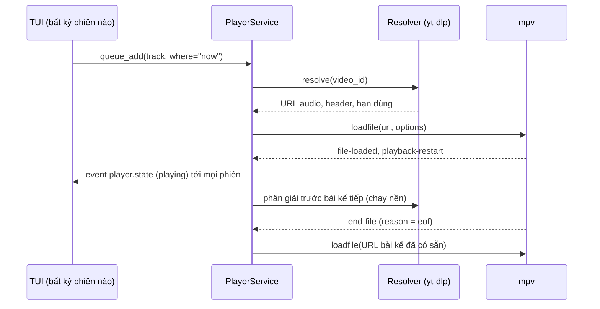
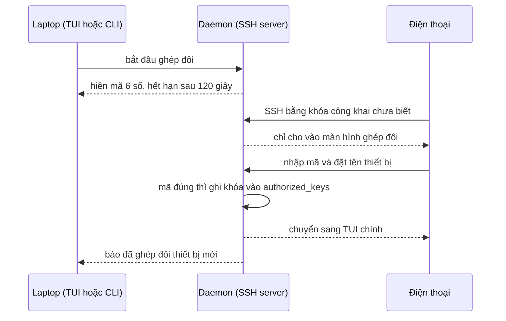
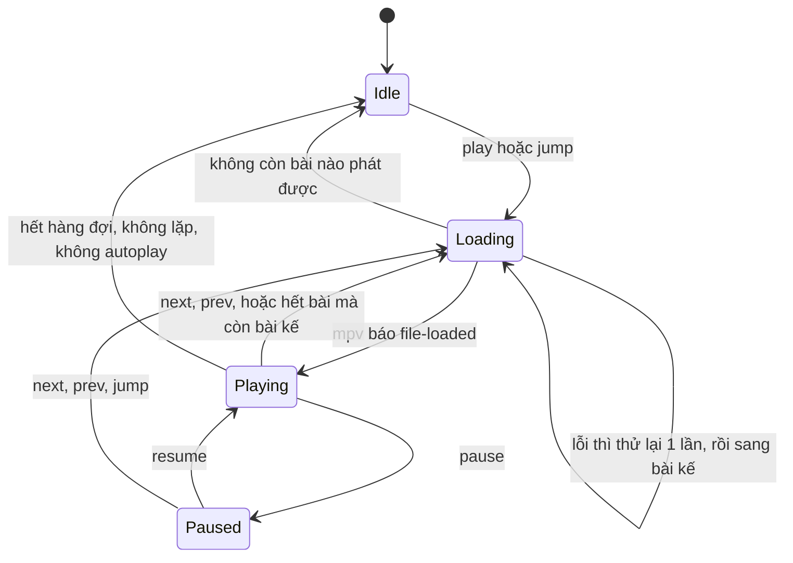

# Đặc tả kỹ thuật: NgheNhacNoAds

**Trình phát nhạc YouTube không quảng cáo trong terminal, điều khiển từ điện thoại qua SSH**

| Mục | Giá trị |
|---|---|
| Phiên bản tài liệu | 0.2 |
| Ngày | 27/09/2026 |
| Trạng thái | Đã duyệt; đang làm mốc M0 |
| Repo | <https://github.com/CuongVo24/NgheNhacNoAds> |
| Nền tảng đầu tiên | Windows 10/11 (tiếp theo: Linux) |
| Mô hình phát hành | Mã nguồn mở, giấy phép MIT |

> **Quy ước**
> - **Chốt**: bạn đã xác nhận.
> - **Đề xuất**: lựa chọn kỹ thuật của người viết, có thể đổi.
> - **[Spike]**: cần thử nghiệm thực tế để xác nhận; làm ở mốc M0 (mục 11).
>
> Tên hiển thị là **NgheNhacNoAds**. Gói PyPI, package Python, lệnh và thư mục dữ liệu dùng chữ thường: `nghenhacnoads`.

---

## 1. Tổng quan

### 1.1 Mục tiêu

- Nghe nhạc từ YouTube / YouTube Music trên laptop mà không có quảng cáo và không cần mở trình duyệt.
- Giao diện là **TUI toàn màn hình** trong terminal.
- Điện thoại trong **cùng mạng Wi-Fi** SSH vào để điều khiển. **Âm thanh phát ra từ laptop**, điện thoại chỉ đóng vai remote.
- Mã nguồn mở, người khác cài được dễ dàng.

**Vì sao không có quảng cáo:** công cụ dùng yt-dlp để lấy thẳng luồng audio của video, rồi phát bằng mpv. Quảng cáo YouTube do trình phát của YouTube chèn vào, nên sẽ không xuất hiện. Riêng đoạn quảng cáo mà YouTuber tự đọc *bên trong* video thì vẫn còn, vì SponsorBlock nằm ngoài phạm vi (mục 1.3).

### 1.2 Kịch bản sử dụng

1. **Ở laptop:** mở terminal, gõ `nghenhacnoads`, TUI hiện ra. Nhấn `/`, gõ "sơn tùng", chọn bài, nhạc phát. Đóng TUI thì nhạc vẫn phát.
2. **Từ điện thoại:** mở Termux/Termius, chạy `ssh -p 2222 yt@192.168.1.23`, vào đúng TUI đó với bố cục gọn cho màn hình dọc. Chuyển bài, chỉnh âm lượng, thêm bài vào hàng đợi.
3. **Nhiều thiết bị cùng lúc:** laptop và điện thoại cùng mở TUI; thao tác ở một nơi, nơi kia cập nhật ngay.
4. **Playlist và radio:** dán link playlist hoặc Mix YouTube để phát cả danh sách. Hết hàng đợi thì autoplay tự thêm bài liên quan.
5. **Lời bài hát và phím media:** xem lời chạy theo nhạc; bấm phím media trên bàn phím hoặc nút tai nghe Bluetooth để chuyển bài.
6. **Lần đầu dùng điện thoại:** ghép đôi bằng mã 6 số hiện trên laptop. Từ lần sau vào thẳng.

### 1.3 Phạm vi

**Trong phạm vi v1.0:**
- Tìm kiếm: YouTube Music (mặc định) và YouTube.
- Phát và điều khiển; hàng đợi.
- Phát playlist/Mix YouTube.
- Playlist cục bộ, yêu thích, lịch sử nghe.
- Autoplay/radio.
- Lời bài hát.
- Phím media của Windows.
- SSH server nhúng và ghép đôi thiết bị.
- Daemon chạy nền.
- Đóng gói để phát hành mã nguồn mở.

**Ngoài phạm vi v1.0:**
- Tải nhạc về nghe offline.
- SponsorBlock.
- Đăng nhập tài khoản YouTube hoặc dùng cookies (playlist riêng tư, danh sách "Đã thích").
- Phát video.
- Điều khiển bằng lệnh đơn kiểu `nghenhacnoads next`.
- Điều khiển qua Internet.
- Linux/macOS: kiến trúc đã chừa chỗ nhưng chưa làm.
- App điện thoại riêng hoặc web UI.

### 1.4 Thuật ngữ

| Thuật ngữ | Nghĩa trong tài liệu |
|---|---|
| Daemon | Tiến trình nền chứa lõi phát nhạc, SSH server và RPC server; sống độc lập với mọi TUI |
| TUI | Giao diện toàn màn hình trong terminal |
| Phiên (session) | Một TUI đang kết nối: TUI cục bộ trên laptop, hoặc một kết nối SSH |
| Resolver | Thành phần dùng yt-dlp để đổi `video_id` thành URL luồng audio |
| JS runtime / EJS | Deno hoặc Node, thứ yt-dlp cần để giải "JavaScript challenge" của YouTube. EJS là bộ script đi kèm (gói `yt-dlp-ejs`) |
| mpv JSON IPC | Giao thức điều khiển mpv qua named pipe (Windows) hoặc unix socket |
| SMTC | System Media Transport Controls: bảng media và phím media của Windows |
| Ghép đôi (pairing) | Thủ tục thêm khóa SSH của điện thoại vào danh sách tin cậy bằng mã dùng một lần |
| LRC | Định dạng lời bài hát có mốc thời gian `[mm:ss.xx]` |

---

## 2. Các quyết định chính

| # | Chủ đề | Lựa chọn | Trạng thái | Lý do |
|---|---|---|---|---|
| D1 | Ngôn ngữ | Python ≥ 3.11 | Chốt | yt-dlp là thư viện Python, gọi trực tiếp được |
| D2 | Truy cập từ điện thoại | SSH server **nhúng trong daemon** (asyncssh) | Chốt | Không cần OpenSSH Server hay quyền admin. Daemon chạy trong phiên đăng nhập nên âm thanh ra đúng loa. Người SSH vào chỉ thấy TUI, không có shell |
| D3 | Giao diện | TUI toàn màn hình, tự co giãn cho điện thoại | Chốt | |
| D4 | Phạm vi mạng | Chỉ LAN/Wi-Fi | Chốt | |
| D5 | Nguồn tìm kiếm | YouTube Music (ytmusicapi) mặc định, thêm YouTube (yt-dlp) | Chốt | |
| D6 | Thư viện TUI | prompt_toolkit | Đề xuất | Có sẵn `prompt_toolkit.contrib.ssh` để chạy app qua asyncssh, hoạt động trên Windows. TUI cục bộ và TUI qua SSH dùng chung code (so sánh ở 6.9) |
| D7 | Trình phát | mpv ≥ 0.39, chạy thành tiến trình riêng, điều khiển qua JSON IPC | Đề xuất | Ổn định, nhẹ, phát luồng mạng tốt, dùng giống nhau trên mọi OS. mpv có sập thì daemon không sập theo |
| D8 | Lấy luồng audio | yt-dlp dùng như thư viện. JS runtime là Deno (mặc định) hoặc Node ≥ 22 | Chốt (thư viện), Đề xuất (runtime) | Từ 11/2025 yt-dlp cần JS runtime bên ngoài để hỗ trợ YouTube đầy đủ |
| D9 | TUI cục bộ nói chuyện với daemon | JSON-RPC 2.0 qua TCP 127.0.0.1, có token | Đề xuất | Đơn giản, chạy giống nhau trên mọi OS, dễ debug |
| D10 | Lưu trữ | SQLite cho dữ liệu, TOML cho cấu hình | Đề xuất | Có sẵn trong Python, mỗi thứ một file, đủ cho dữ liệu cá nhân |
| D11 | Lời bài hát | ytmusicapi, dự phòng bằng LRCLIB | Đề xuất | Cả hai có lời kèm mốc thời gian và không cần API key |
| D12 | Phím media | SMTC chạy trong daemon qua pywinrt, dự phòng bằng `--media-controls` của mpv | Đề xuất [Spike] | Tự quản metadata và nút next/prev |
| D13 | Phân phối | PyPI, cài bằng `uv tool install` hoặc `pipx install` | Đề xuất | Cách phổ biến cho CLI viết bằng Python |

---

## 3. Yêu cầu chức năng

Ưu tiên: **P0** thuộc MVP (M1–M2). **P1** phải có trong v1.0 (M3–M5).

| ID | Yêu cầu | Ưu tiên | Tiêu chí chấp nhận |
|---|---|---|---|
| FR-01 | Tìm trên YouTube Music (mặc định lọc "bài hát") | P0 | Nhấn Enter trả về tối đa 20 kết quả, gồm tên bài, nghệ sĩ, album, thời lượng |
| FR-02 | Tìm trên YouTube thường qua yt-dlp | P0 | Như FR-01; cột nghệ sĩ hiện tên kênh |
| FR-03 | Đổi nguồn tìm kiếm bằng 1 phím hoặc chạm | P0 | Truy vấn đang có được chạy lại trên nguồn mới |
| FR-04 | Nhận link dán vào ô tìm kiếm: `youtube.com/watch`, `youtu.be`, `music.youtube.com`, playlist, Mix | P0 (video), P1 (playlist/Mix) | Link một bài cho ra đúng 1 kết quả. Link playlist xử lý theo FR-18 |
| FR-05 | Phát/tạm dừng, bài sau, bài trước | P0 | Nếu bài đã phát quá 3 giây thì "bài trước" phát lại bài hiện tại từ đầu |
| FR-06 | Tua ±5 s, ±30 s; chạm thanh tiến trình để tua | P0 | Không tua được khi đang phát livestream |
| FR-07 | Âm lượng 0–100 (bước 5), tắt tiếng | P0 | Âm lượng được nhớ giữa các lần chạy |
| FR-08 | Hàng đợi: phát ngay, phát tiếp theo, thêm vào cuối, xóa, di chuyển, nhảy tới, xóa các bài chưa phát | P0 | Thao tác theo `item_id`, nên hai thiết bị thao tác cùng lúc không làm lệch mục |
| FR-09 | Lặp (tắt / một bài / tất cả) và trộn bài | P0 | Tắt trộn thì các bài chưa phát quay về thứ tự cũ |
| FR-10 | Thanh "Đang phát" | P0 | Hiện tên bài, nghệ sĩ, tiến trình, thời gian, âm lượng, trạng thái lặp/trộn/autoplay, trạng thái đang tải |
| FR-11 | Một bài lỗi không làm dừng cả hàng đợi | P0 | Thử lại 1 lần (phân giải lại URL); vẫn lỗi thì bỏ qua và báo trên TUI |
| FR-12 | SSH server nhúng, chỉ xác thực bằng khóa công khai | P0 | Theo mục 6.10 |
| FR-13 | Ghép đôi thiết bị bằng mã 6 số; xem và thu hồi thiết bị | P0 | Ngoài lúc đang ghép đôi, khóa lạ bị từ chối |
| FR-14 | Nhiều phiên chạy cùng lúc, trạng thái phát đồng bộ | P0 | Thay đổi ở một phiên hiện ở các phiên khác trong ≤ 500 ms |
| FR-15 | Bố cục co giãn: rộng (≥ 100 cột), vừa (60–99), điện thoại (< 60) | P0 | Vẫn dùng được ở kích thước 40×15 ký tự |
| FR-16 | Daemon chạy nền | P0 | Đóng mọi TUI/SSH thì nhạc vẫn phát. `nghenhacnoads` tự bật daemon nếu daemon chưa chạy |
| FR-17 | Tự chạy daemon khi đăng nhập Windows (bật/tắt được) | P0 | Có lệnh `nghenhacnoads autostart on/off/status` và công tắc trong tab Cài đặt |
| FR-18 | Phát playlist/Mix YouTube | P1 | Chọn được phát ngay (thay hàng đợi), thêm vào hàng đợi, hoặc lưu thành playlist cục bộ. Bỏ qua video riêng tư hoặc đã xóa |
| FR-19 | Playlist cục bộ | P1 | Tạo, đổi tên, xóa; thêm/xóa/sắp xếp bài; phát hoặc trộn cả playlist |
| FR-20 | Yêu thích | P1 | Một phím để thích/bỏ thích. "Yêu thích" là một playlist hệ thống |
| FR-21 | Lịch sử nghe | P1 | Ghi khi đã nghe ≥ 30 s hoặc ≥ 50% thời lượng. Xem, phát lại, xóa được |
| FR-22 | Autoplay/radio | P1 | Khi bài cuối của hàng đợi bắt đầu phát thì chuẩn bị sẵn bài liên quan. Không lặp lại bài trong 100 lượt nghe gần nhất. Bật/tắt bằng 1 phím |
| FR-23 | Lời bài hát | P1 | Có mốc thời gian thì tự cuộn và tô sáng dòng đang hát; không có thì hiện lời thường. Chỉnh lệch được ±0,5 s |
| FR-24 | Phím media và bảng media của Windows (SMTC) | P1 | Phát/dừng/sau/trước hoạt động kể cả khi không cửa sổ nào đang focus. Hiện tên bài, nghệ sĩ, ảnh bìa |
| FR-25 | Khôi phục hàng đợi sau khi daemon khởi động lại | P1 | Khôi phục đúng bài và vị trí, ở trạng thái tạm dừng |
| FR-26 | Lệnh `nghenhacnoads doctor` | P1 | Kiểm tra phụ thuộc, phiên bản, cổng, IP LAN; in cách sửa cho từng lỗi |
| FR-27 | Giao diện đa ngôn ngữ (vi/en) | P1 | Có đủ tiếng Việt và tiếng Anh; mặc định theo ngôn ngữ hệ điều hành, đổi được trong Cài đặt |

---

## 4. Yêu cầu phi chức năng

Các con số là mục tiêu ban đầu, sẽ xác nhận lại sau các spike.

| ID | Yêu cầu | Mục tiêu |
|---|---|---|
| NFR-01 | Độ trễ phát | Từ lúc chọn bài đến lúc có tiếng: ≤ 4 s lần đầu, ≤ 1,5 s nếu bài đã được phân giải sẵn. Khoảng lặng khi tự chuyển bài ≤ 1 s |
| NFR-02 | Độ trễ điều khiển | Bấm tạm dừng hoặc đổi âm lượng trên điện thoại có hiệu lực trong ≤ 300 ms (trong LAN) |
| NFR-03 | Tài nguyên | Daemon ≤ 150 MB RAM, mpv ≤ 80 MB. CPU trung bình < 3% khi đang phát |
| NFR-04 | Độ bền | Chạy liên tục 24 giờ không rò bộ nhớ. mpv sập thì tự khởi động lại và phát tiếp trong ≤ 5 s |
| NFR-05 | Bảo mật | Theo mục 7 |
| NFR-06 | Tiếng Việt / Unicode | Tên bài tiếng Việt, emoji, chữ CJK hiển thị đúng. Gõ có dấu được từ bàn phím điện thoại và từ Unikey/EVKey |
| NFR-07 | Tương thích terminal | Laptop: Windows Terminal, conhost (Windows 10+). Điện thoại Android (ưu tiên kiểm thử): Termux, Termius, JuiceSSH. iOS (Termius, Blink): cố gắng hỗ trợ, không nằm trong ma trận kiểm thử bắt buộc |
| NFR-08 | Dễ chuyển nền tảng | Code riêng cho Windows chỉ nằm trong `nghenhacnoads/platform/windows.py` và phần kết nối named pipe. Phần lõi không gọi API Windows |
| NFR-09 | Dễ bảo trì | Lõi (queue, máy trạng thái, các parser) có test tự động, độ phủ ≥ 80%. CI trên Windows phải xanh |
| NFR-10 | Log | Xoay vòng 5 file × 2 MB. Không ghi URL luồng đầy đủ, token hay khóa |
| NFR-11 | Cài đặt | Người mới làm theo README cài xong trong ≤ 10 phút |

---

## 5. Kiến trúc tổng thể

### 5.1 Sơ đồ

```
┌────────────────────────┐                  ┌────────────────────────┐
│ Điện thoại (Android)   │                  │ Terminal trên laptop   │
│ Termux / Termius       │                  │ lệnh `nghenhacnoads`   │
└───────────┬────────────┘                  └───────────┬────────────┘
            │ SSH, cổng 2222 (chỉ LAN)                  │ JSON-RPC, 127.0.0.1
            ▼                                           ▼
┌─────────────────────────────────────────────────────────────────────┐
│ nghenhacnoads-daemon: tiến trình nền trong phiên đăng nhập Windows  │
│                                                                     │
│  ┌─────────────────────────────┐    ┌─────────────────────────────┐ │
│  │ SSH server (asyncssh)       │    │ RPC server (127.0.0.1)      │ │
│  │ mỗi phiên SSH = 1 TUI       │    │ TUI cục bộ chạy trong       │ │
│  │ prompt_toolkit              │    │ tiến trình `nghenhacnoads`  │ │
│  └──────────────┬──────────────┘    └──────────────┬──────────────┘ │
│                 └─────────────────┬────────────────┘                │
│                                   ▼  PlayerClient                   │
│  ┌───────────────────────────────────────────────────────────────┐  │
│  │ Lõi: PlayerService · Queue · Library · Autoplay · Lyrics      │  │
│  │      EventBus (đẩy trạng thái tới mọi phiên)                  │  │
│  └──────┬───────────────┬────────────────┬───────────────┬───────┘  │
│         ▼               ▼                ▼               ▼          │
│    Resolver        Tìm kiếm          Lưu trữ         Platform       │
│    yt-dlp + Deno   ytmusicapi,       SQLite,         autostart,     │
│         │          yt-dlp, LRCLIB    config.toml     chống ngủ,     │
│         ▼ URL audio                                  SMTC           │
│    MpvBackend ── JSON IPC (named pipe) ──▶ mpv.exe ──▶ loa laptop   │
└─────────────────────────────────────────────────────────────────────┘
```

### 5.2 Thành phần

| Thành phần | Trách nhiệm | Công nghệ |
|---|---|---|
| `core.PlayerService` | Máy trạng thái phát nhạc; điều phối resolver, mpv và hàng đợi. Là nguồn sự thật duy nhất | asyncio |
| `core.Queue` | Logic hàng đợi thuần: thêm, xóa, di chuyển, lặp, trộn. Không có I/O | Python thuần |
| `core.Library` | Playlist, yêu thích, lịch sử | SQLite |
| `core.Autoplay` | Chọn bài liên quan khi hàng đợi sắp hết | ytmusicapi / yt-dlp |
| `core.EventBus` | Đẩy trạng thái tới mọi phiên (pub/sub) | Mỗi subscriber một `asyncio.Queue` |
| `sources.Resolver` | Đổi `video_id` thành URL audio kèm header và hạn dùng; cache; phân giải trước | yt-dlp |
| `sources.Search` | Tìm trên YouTube Music / YouTube; đọc playlist và Mix | ytmusicapi, yt-dlp |
| `sources.Lyrics` | Lấy lời theo thứ tự nguồn, parse LRC, cache | ytmusicapi, httpx (LRCLIB) |
| `backends.MpvBackend` | Khởi chạy, giám sát và điều khiển mpv | mpv JSON IPC |
| `api.PlayerClient` | Giao diện async chung cho TUI, có bản in-process và bản RPC | `typing.Protocol` |
| `api.RpcServer` / `RpcClient` | JSON-RPC 2.0 dạng NDJSON qua TCP loopback | asyncio streams |
| `remote.SshServer` | SSH nhúng: xác thực, ghép đôi, lọc IP LAN, giới hạn phiên | asyncssh, `prompt_toolkit.contrib.ssh` |
| `tui` | Ứng dụng TUI: bố cục co giãn, phím tắt, chuột/chạm | prompt_toolkit |
| `platform.windows` | Tự chạy khi đăng nhập, chống ngủ, tạo tiến trình nền, SMTC, lấy IP LAN | winreg, ctypes, pywinrt |
| `cli` | Lệnh quản trị: daemon, ssh, autostart, doctor, config | argparse |

### 5.3 Mô hình tiến trình trên Windows

- **Daemon** luôn chạy trong **phiên đăng nhập tương tác** của người dùng. Nó được bật bởi lệnh `nghenhacnoads`, hoặc tự chạy khi đăng nhập (FR-17). mpv là tiến trình con của daemon, nên âm thanh ra thiết bị mặc định của người dùng.
- **Điện thoại** không tạo tiến trình nào trên Windows. Nó chỉ nói chuyện với SSH server bên trong daemon, và TUI của phiên đó cũng chạy ngay trong daemon.
- **So với OpenSSH Server của Windows:** tiến trình khởi chạy qua OpenSSH nằm trong phiên dịch vụ không tương tác (session 0). Ở đó GUI không hiển thị, và không có gì đảm bảo âm thanh ra được loa của người đang đăng nhập. Kiến trúc này tránh được vấn đề đó, và cũng không cần quyền admin để bật OpenSSH Server.
- **Ràng buộc:** người dùng phải **đang đăng nhập** Windows (khóa màn hình thì vẫn được). Nếu máy ngủ, tắt hoặc đã đăng xuất thì điện thoại không điều khiển được.
- **TUI cục bộ** (`nghenhacnoads`) là một tiến trình riêng, nối vào daemon qua RPC. Tắt nó không ảnh hưởng tới nhạc.

### 5.4 Luồng chính

**a) Phát một bài và tự chuyển bài**



**b) Ghép đôi điện thoại lần đầu**



**c) URL hết hạn hoặc lỗi 403 giữa chừng:** xem mục 6.4.

---

## 6. Thiết kế chi tiết

### 6.1 Cấu trúc mã nguồn

```
NgheNhacNoAds/
├── pyproject.toml              # uv + hatchling
├── uv.lock
├── README.md · README.vi.md · LICENSE · CHANGELOG.md · CONTRIBUTING.md · SECURITY.md
├── docs/
│   ├── SPEC.md                 # tài liệu này
│   ├── adr/                    # mỗi quyết định D1–D13 một file
│   ├── spikes/                 # kết quả thử nghiệm ở M0
│   └── install-windows.md · phone-setup.md · troubleshooting.md · keybindings.md
├── src/nghenhacnoads/
│   ├── __main__.py · cli.py · daemon.py · config.py · paths.py · logs.py
│   ├── i18n/                   # vi.toml, en.toml
│   ├── core/                   # models · events · queue · player · autoplay · library
│   ├── sources/                # resolver · search_ytmusic · search_youtube · urls · lyrics · lrc
│   ├── backends/               # base (PlayerBackend) · mpv · mpv_transport · fake
│   ├── storage/                # db · migrations/0001_init.sql
│   ├── api/                    # client (Protocol + InProcessClient) · rpc_server · rpc_client
│   ├── remote/                 # ssh_server · auth · pairing · netfilter
│   ├── tui/                    # app · layout · keys · theme · views/ · widgets/
│   └── platform/               # base · windows · posix (sau này)
└── tests/                      # unit/ · integration/ · fixtures/
```

### 6.2 Mô hình dữ liệu

```python
class Source(StrEnum):     YTMUSIC = "ytmusic"; YOUTUBE = "youtube"
class RepeatMode(StrEnum): OFF = "off"; ONE = "one"; ALL = "all"
class Status(StrEnum):     IDLE = "idle"; LOADING = "loading"; PLAYING = "playing"; PAUSED = "paused"

class Track(BaseModel, frozen=True):      # pydantic v2
    video_id: str                          # 11 ký tự
    title: str                             # đã chuẩn hóa Unicode NFC
    artists: tuple[str, ...] = ()
    album: str | None = None
    duration_s: int | None = None          # None = livestream hoặc chưa rõ
    thumbnail_url: str | None = None
    source: Source
    is_live: bool = False

class QueueItem(BaseModel, frozen=True):
    item_id: str                           # uuid4 rút gọn, không đổi suốt vòng đời của mục
    track: Track
    origin: str                            # search | url | playlist:<id> | yt-playlist:<id> | autoplay | history
    added_by: str                          # tên phiên / thiết bị
    added_at: datetime

class PlayerState(BaseModel):
    status: Status
    current_item_id: str | None
    position_s: float
    duration_s: float | None
    volume: int                            # 0–100
    muted: bool
    repeat: RepeatMode
    shuffle: bool
    autoplay: bool
    buffering: bool
    queue_version: int                     # tăng mỗi khi hàng đợi thay đổi
    error: str | None                      # lỗi gần nhất, để TUI hiện thông báo
```

### 6.3 Lõi phát nhạc

**Máy trạng thái**



**Quy tắc**

- **Xử lý tuần tự:** lệnh từ mọi phiên đều đi vào cùng một event loop asyncio, nên được xử lý lần lượt. Các thư viện chặn luồng (yt-dlp, ytmusicapi, sqlite3) chạy trong thread pool riêng, tối đa 3 luồng.
- **Hàng đợi:** gồm danh sách `QueueItem`, chỉ số bài hiện tại, và ngăn xếp các bài đã phát (để "bài trước" vẫn đúng khi đang trộn).
  - "Phát ngay": chèn ngay sau bài hiện tại rồi chuyển sang bài đó; các bài phía sau giữ nguyên.
- **Trộn bài:**
  - Bật: xáo các bài *chưa phát* và lưu lại thứ tự gốc.
  - Tắt: các bài còn lại quay về thứ tự gốc.
- **Lặp một bài:** hết bài thì `seek 0`. Không phân giải lại, trừ khi URL sắp hết hạn.
- **Làm trước ở nền:** khi một bài bắt đầu phát, phân giải trước bài kế tiếp và tải lời của bài hiện tại.
- **Xử lý lỗi:**
  - Khi mpv báo `end-file` với `reason=error`, hoặc resolver lỗi: bỏ cache và phân giải lại 1 lần.
  - Vẫn lỗi: đánh dấu mục lỗi, báo lên TUI, chuyển sang bài kế.
  - 5 bài liên tiếp đều lỗi: dừng hẳn và báo "có thể cần cập nhật yt-dlp". Việc này tránh vòng lặp vô tận khi YouTube đổi API.
- **Cập nhật vị trí:** đọc `time-pos` từ mpv. Sự kiện `player.position` gửi tối đa 1 lần/giây cho phiên SSH, 4 lần/giây cho phiên cục bộ.
- **Lưu trạng thái:**
  - Hàng đợi ghi vào SQLite sau mỗi thay đổi, gộp các thay đổi trong vòng 1 s.
  - Vị trí phát ghi mỗi 10 s.
  - Nhờ vậy máy có tắt đột ngột cũng mất rất ít.

### 6.4 Tích hợp yt-dlp

**Tùy chọn** (yt-dlp dùng dạng thư viện, `from yt_dlp import YoutubeDL`):

```python
BASE = {
    "quiet": True, "no_warnings": True, "noprogress": True,
    "skip_download": True,
    "socket_timeout": 15,
    "extractor_retries": 2,
    "cachedir": str(paths.cache_dir / "yt-dlp"),   # cache player JS và lời giải challenge
    "js_runtimes": {"deno": {}},                    # lấy từ config, vd {"node": {"path": "C:/.../node.exe"}}
    "remote_components": [],                        # opt-in: ["ejs:github"] khi thiếu gói yt-dlp-ejs
    "logger": YtDlpLogAdapter(log),
}
RESOLVE  = BASE | {"format": "bestaudio[acodec=opus]/bestaudio[ext=m4a]/bestaudio/best",
                   "noplaylist": True}
SEARCH   = BASE | {"extract_flat": "in_playlist"}             # truy vấn "ytsearch20:<từ khóa>"
PLAYLIST = BASE | {"extract_flat": "in_playlist", "playlistend": 500}
```

- `js_runtimes` và `remote_components` là tham số có thật của `YoutubeDL` (đã kiểm tra trong bản 2026.08.19). Mặc định yt-dlp chỉ bật Deno (cần Deno ≥ 2.3). Muốn dùng Node (≥ 22) thì phải khai báo rõ. Phụ thuộc cần là `yt-dlp[default]` để có kèm gói `yt-dlp-ejs`.
- **Không hard-code `player_client`.** Dùng mặc định của yt-dlp, vì yt-dlp đổi giá trị này liên tục để theo kịp YouTube. Chỉ cho ghi đè qua `ytdlp.extractor_args` trong config.
- Không dùng chung một đối tượng `YoutubeDL` cho nhiều luồng. Mỗi luồng của executor giữ một instance riêng (thread-local).

**Kết quả phân giải**

```python
class ResolvedStream(BaseModel):
    url: str
    http_headers: dict[str, str]
    expires_at: datetime        # đọc từ tham số `expire` trong URL; không có thì lấy now + 5 giờ
    format_id: str; acodec: str; abr: float | None
```

- **Cache:** LRU trong bộ nhớ, 200 mục, khóa theo `video_id`. Mục còn hạn dưới 10 phút coi như đã hết hạn.
- **Hết hạn giữa chừng:** tạm dừng lâu rồi phát tiếp có thể gặp 403 hoặc `end-file` lỗi. Khi đó phân giải lại rồi `loadfile` với `start=<vị trí cũ>`.
- **Livestream:** vẫn phát được (ví dụ lofi radio 24/7), nhưng tắt tua và autoplay không kích hoạt.

**Ánh xạ lỗi** (bắt `yt_dlp.utils.DownloadError`, phân loại theo thông báo lỗi):

| Tình huống | Thông báo trên TUI | Hành động |
|---|---|---|
| Thiếu JS runtime hoặc thiếu EJS | "Thiếu Deno/Node cho yt-dlp, hãy chạy `nghenhacnoads doctor`" | Dừng, không thử bài khác |
| Video riêng tư, đã xóa, không khả dụng | "Không phát được: video không khả dụng" | Bỏ qua bài |
| Video giới hạn độ tuổi / cần đăng nhập | "Video cần đăng nhập (chưa hỗ trợ)" | Bỏ qua bài |
| Chặn theo khu vực | "Video bị chặn ở khu vực của bạn" | Bỏ qua bài |
| "Sign in to confirm you're not a bot" | "YouTube yêu cầu xác minh, xem troubleshooting" | Dừng hàng đợi |
| Lỗi mạng hoặc hết thời gian chờ | "Lỗi mạng, đang thử lại…" | Thử lại 1 lần |

### 6.5 Tích hợp YouTube Music (ytmusicapi)

- **Không đăng nhập:** dùng `YTMusic()`; có thể cấu hình `location`.
- **Tìm kiếm:** `search(query, filter="songs", limit=20)`; có phím đổi sang `filter="videos"`. Lấy các trường `videoId`, `title`, `artists`, `album`, `duration_seconds`, `thumbnails`.
- **Radio / autoplay:**
  - Gọi `get_watch_playlist(videoId=<bài gốc>, radio=True, limit=25)` và lấy `tracks`.
  - Bỏ các bài đã có trong hàng đợi hoặc nằm trong 100 lượt nghe gần nhất.
  - Mỗi lần thêm `playback.autoplay_batch` bài (mặc định 10), gắn `origin="autoplay"`.
  - Dự phòng: đọc Mix YouTube `https://www.youtube.com/watch?v=<id>&list=RD<id>` bằng yt-dlp.
- **Lời bài hát:** `get_watch_playlist(videoId)` trả về trường `lyrics` (một browseId). Sau đó gọi `get_lyrics(browseId, timestamps=True)` để lấy lời có mốc thời gian nếu có.
- **Chạy nền:** ytmusicapi dùng `requests` (đồng bộ), nên chạy trong thread pool với timeout 10 s.
- **Dự phòng:** ytmusicapi lỗi 2 lần liên tiếp thì tự chuyển tìm kiếm sang YouTube (yt-dlp) và báo cho người dùng.

### 6.6 Tích hợp mpv

**Khởi chạy:** một tiến trình mpv dùng suốt đời daemon, không có cửa sổ (trên Windows dùng cờ `CREATE_NO_WINDOW`).

```
mpv --idle=yes --no-video --force-window=no --no-terminal --no-config
    --input-ipc-server=\\.\pipe\nghenhacnoads-mpv-<chuỗi ngẫu nhiên>
    --no-input-default-bindings --input-conf=<thư mục dữ liệu>\mpv-input.conf
    --ytdl=no --cache=yes --demuxer-max-bytes=32MiB --demuxer-readahead-secs=20
    --volume=<âm lượng đã lưu> --volume-max=100
    --media-controls=<yes|no tùy D12>          # chỉ thêm khi mpv ≥ 0.39
    --log-file=<thư mục log>\mpv.log --msg-level=all=warn
```

- `--no-config`: tránh để file cấu hình mpv riêng của người dùng làm lệch hành vi. Có tùy chọn `mpv.use_user_config = true` để tắt điều này, và `mpv.extra_args` để thêm tham số.
- **Kiểm tra phiên bản** bằng `mpv --version` trước khi chạy. Yêu cầu ≥ 0.38, khuyến nghị ≥ 0.39 (bản có `--media-controls`). mpv gặp tùy chọn không biết sẽ không khởi động, nên chỉ thêm `--media-controls` khi đủ phiên bản.
- **Kết nối IPC:**
  - Windows: named pipe, qua `ProactorEventLoop.create_pipe_connection`.
  - POSIX (sau này): `asyncio.open_unix_connection`.
  - Sau khi khởi chạy mpv, thử kết nối lặp lại trong tối đa 5 s.
- **Gửi lệnh bằng named arguments** của JSON IPC. Từ mpv 0.38, `loadfile` có thêm tham số `index` đứng trước `options`, nên gọi theo vị trí rất dễ sai.

```json
{"command": {"name": "loadfile", "url": "<URL audio>", "flags": "replace",
             "options": {"user-agent": "<User-Agent do yt-dlp trả về>",
                         "force-media-title": "Nơi Này Có Anh — Sơn Tùng M-TP",
                         "start": "83"}},
 "request_id": 42}
```

- **Header HTTP:**
  - `User-Agent` truyền qua tùy chọn `user-agent`.
  - Chỉ header thật sự cần (Referer, Origin) mới đi qua `http-header-fields`. Tùy chọn này là danh sách phân tách bằng dấu phẩy, nên dấu phẩy bên trong giá trị phải được escape. Làm theo cách `ytdl_hook.lua` của mpv.
- **Theo dõi:**
  - Thuộc tính (`observe_property`): `pause`, `time-pos`, `duration`, `volume`, `mute`, `idle-active`, `paused-for-cache`.
  - Sự kiện: `file-loaded`, `end-file` (có `reason` như eof/error/stop và `file_error`), `playback-restart`, `client-message`, `shutdown`.
- **Phím media qua mpv** (chỉ dùng khi D12 chọn phương án dự phòng). Hàng đợi nằm ở daemon chứ không ở playlist của mpv, nên `mpv-input.conf` biến phím media thành thông điệp gửi cho daemon. Tên phím xem bằng `mpv --input-keylist`.

```
PLAYPAUSE cycle pause
PLAY      set pause no
PAUSE     set pause yes
NEXT      script-message nghenhacnoads next
PREV      script-message nghenhacnoads prev
STOP      script-message nghenhacnoads stop
```

- **Khi mpv sập bất thường:**
  - Khởi động lại mpv.
  - Nạp lại bài hiện tại ở vị trí cũ (phân giải lại URL nếu cần) và giữ nguyên trạng thái tạm dừng.
  - Sập quá 3 lần trong 1 phút thì dừng hẳn và báo lỗi.

### 6.7 Lời bài hát

**Thứ tự nguồn**
1. ytmusicapi, loại có mốc thời gian.
2. LRCLIB, trường `syncedLyrics`.
3. ytmusicapi, lời thường.
4. LRCLIB, trường `plainLyrics`.
5. Không có nguồn nào: hiện "Không tìm thấy lời".

**LRCLIB**
- Gọi `GET https://lrclib.net/api/get?track_name=&artist_name=&album_name=&duration=` (khớp chính xác). Không thấy thì thử `GET /api/search?q=`.
- Không cần API key. Nên gửi `User-Agent` dạng `NgheNhacNoAds/<version> (+https://github.com/CuongVo24/NgheNhacNoAds)`.
- Dùng các trường `syncedLyrics`, `plainLyrics`, `instrumental`, `duration`.

**Làm sạch tiêu đề** (cho video YouTube thường)
- Nếu yt-dlp trả về trường `track`/`artist` thì dùng luôn.
- Nếu không, tách dạng "Nghệ sĩ - Tên bài" và bỏ các cụm như `(Official Music Video)`, `[MV]`, `Lyrics`, `Lyric Video`, `Official Audio`, `4K`, `M/V`.

**Parse LRC:** hỗ trợ nhiều mốc thời gian trên một dòng và thẻ `[offset:]`. Tìm dòng đang hát bằng `bisect`.

**Hiển thị:** dòng đang hát được tô sáng và giữ ở giữa màn hình. Phím `[` / `]` chỉnh lệch ±0,5 s; độ lệch lưu riêng cho từng bài.

**Cache:** lưu trong bảng `lyrics_cache`, kể cả kết quả "không tìm thấy" (7 ngày sau mới thử lại). Không đóng gói hay commit lời bài hát vào repo.

### 6.8 Phím media (SMTC)

| Phương án | Cách làm | Ưu | Nhược |
|---|---|---|---|
| **A (ưu tiên):** SMTC trong daemon | Dùng pywinrt tạo một `Windows.Media.Playback.MediaPlayer` và tắt `CommandManager` của nó. Lấy `SystemMediaTransportControls` từ đối tượng này để đặt metadata (tên bài, nghệ sĩ, album, ảnh bìa lấy từ thumbnail) và nhận sự kiện bấm nút | Tự quản hoàn toàn: nút next/prev luôn bật, có ảnh bìa, không phụ thuộc playlist của mpv | Thêm phụ thuộc chỉ dành cho Windows (`winrt-*`). Cần kiểm tra có wheel cho Python 3.14 |
| **B (dự phòng):** SMTC có sẵn trong mpv ≥ 0.39 | `--media-controls=yes`, kèm `mpv-input.conf` ở mục 6.6 và `force-media-title` | Gần như không phải viết code | Chưa rõ có hoạt động khi không có cửa sổ video. Nút next có thể bị tắt khi playlist của mpv chỉ có 1 bài. Metadata hạn chế |

**[Spike S3]:** thử cả hai. Nếu A chạy ổn thì chọn A, và khi đó chạy mpv với `--media-controls=no` để Windows không hiện hai mục media trùng nhau.

### 6.9 Giao diện TUI

**Chọn thư viện (D6)**

| Tiêu chí | prompt_toolkit | Textual |
|---|---|---|
| Chạy qua SSH | Có sẵn `prompt_toolkit.contrib.ssh` (`PromptToolkitSSHServer`, `PromptToolkitSSHSession`) dựa trên asyncssh, tự xử lý khi terminal đổi kích thước | Không có chính thức. Maintainer gợi ý chạy app trong tiến trình con. Cách tự viết driver thì dựa trên `LinuxDriver`, mà driver này dùng `termios` nên không chạy trên Windows |
| Nhiều app trong một tiến trình | Có (`create_app_session` cho từng phiên) | Không phải mục tiêu thiết kế |
| Widget có sẵn, tốc độ làm | Mức thấp hơn, phải tự dựng layout | Rất tốt (CSS, nhiều widget có sẵn) |
| Rủi ro trên Windows | Thấp đến trung bình, xác nhận ở Spike S2 | Cao |

**Kết luận:** chọn prompt_toolkit.
- **Phương án B** (nếu Spike S2 thất bại): chạy TUI trong tiến trình con gắn với ConPTY (pywinpty) và chuyển tiếp byte qua kênh SSH. Khi đó có thể xét lại Textual.

**Phiên và trạng thái**
- Mỗi phiên có một `Application` riêng, gồm một `PlayerClient` và một `UiStore` (tab hiện tại, ô tìm kiếm, kết quả, con trỏ, menu).
- Trạng thái phát là **chung** cho mọi phiên. Trạng thái giao diện là **riêng** của từng phiên.
- Khi `EventBus` có sự kiện, phiên cập nhật store rồi gọi `app.invalidate()` để vẽ lại.

**Bố cục rộng** (minh họa):

```
┌ NgheNhacNoAds ────────────────────────────────────── SSH 192.168.1.23:2222 · 2 phiên ┐
│ [1 Tìm kiếm]  2 Hàng đợi (12)  3 Playlist  4 Lịch sử  5 Lời  6 Cài đặt               │
├──────────────────────────────────────────────────────┬───────────────────────────────┤
│ / sơn tùng                           Nguồn: YT Music │ Tiếp theo                     │
│ ▸ Chúng Ta Của Tương Lai   Sơn Tùng M-TP    4:12     │  1 Hãy Trao Cho Anh           │
│   Nơi Này Có Anh           Sơn Tùng M-TP    4:20     │  2 Lạc Trôi                   │
│   Lạc Trôi                 Sơn Tùng M-TP    3:53     │  3 Có Chắc Yêu Là Đây         │
│   Hãy Trao Cho Anh         Sơn Tùng M-TP    4:05     │  + autoplay: bật              │
├──────────────────────────────────────────────────────┴───────────────────────────────┤
│ ▶ Nơi Này Có Anh — Sơn Tùng M-TP                         vol 70  lặp: tắt  trộn: tắt │
│ 1:23 ━━━━━━━━━━━━━━●────────────────────────────── 4:20    [|<]  [ || ]  [>|]        │
└──────────────────────────────────────────────────────────────────────────────────────┘
```

**Bố cục điện thoại** (dưới 60 cột): chỉ một khung chính, mỗi bài chiếm 2 dòng, các nút đủ to để chạm:

```
┌──────────────────────────────────┐
│[Tìm] Đợi List Sử Lời Cài         │
│ / sơn tùng                 [YTM] │
│ ▸ Chúng Ta Của Tương Lai         │
│   Sơn Tùng M-TP · 4:12           │
│   Nơi Này Có Anh                 │
│   Sơn Tùng M-TP · 4:20           │
│   Lạc Trôi                       │
│   Sơn Tùng M-TP · 3:53           │
├──────────────────────────────────┤
│ ▶ Nơi Này Có Anh                 │
│ 1:23 ━━━━━●─────────────── 4:20  │
│  [|<]   [ || ]   [>|]   [-] [+]  │
└──────────────────────────────────┘
```

**Các tab:**
- 1 Tìm kiếm
- 2 Hàng đợi
- 3 Playlist (có "Yêu thích" ở đầu)
- 4 Lịch sử
- 5 Lời bài hát
- 6 Cài đặt: SSH (IP, cổng, fingerprint, ghép đôi, thiết bị), autoplay, autostart, giao diện, phiên bản các phụ thuộc

**Phím tắt mặc định** (chỉ dùng phím có trên bàn phím điện thoại; sau này có thể cho cấu hình lại):

| Phím | Ngữ cảnh | Hành động |
|---|---|---|
| `Space` | Chung | Phát / tạm dừng |
| `n` / `p` | Chung | Bài sau / bài trước |
| `←` / `→` | Chung | Tua −5 s / +5 s |
| `,` / `.` | Chung | Tua −30 s / +30 s |
| `-` / `+` (hoặc `=`) | Chung | Âm lượng −5 / +5 |
| `m` | Chung | Tắt / bật tiếng |
| `r` | Chung | Chế độ lặp: tắt → một bài → tất cả |
| `s` | Chung | Bật / tắt trộn bài |
| `o` | Chung | Bật / tắt autoplay |
| `l` | Chung | Thích / bỏ thích bài đang phát |
| `1`…`6`, `Tab` / `Shift+Tab` | Chung | Chuyển tab |
| `/` | Chung | Nhảy tới ô tìm kiếm |
| `?` | Chung | Bảng phím tắt |
| `Esc` | Chung | Rời ô nhập / đóng menu |
| `q` | Chung | Đóng phiên của mình (nhạc vẫn phát) |
| `Q` | Chung | Tắt daemon, có hỏi xác nhận (dùng được cả từ điện thoại) |
| `↑` `↓` / `k` `j` | Danh sách | Di chuyển con trỏ |
| `Enter` | Kết quả tìm kiếm, lịch sử, playlist | Làm theo `ui.enter_action`. Mặc định mở menu: Phát ngay · Phát tiếp theo · Thêm vào cuối · Thêm vào playlist… · Radio từ bài này · Thích |
| `a` / `A` | Kết quả tìm kiếm, lịch sử, playlist | Thêm vào cuối hàng đợi / phát tiếp theo |
| `t` | Tab Tìm kiếm | Đổi nguồn YT Music ⇄ YouTube |
| `Enter` | Hàng đợi | Nhảy tới bài đó |
| `d` | Hàng đợi, playlist | Xóa mục |
| `K` / `J` | Hàng đợi, playlist | Đưa mục lên / xuống |
| `c` | Hàng đợi | Xóa các bài chưa phát (có hỏi xác nhận) |
| `[` / `]` | Tab Lời bài hát | Chỉnh lệch lời −0,5 s / +0,5 s |

**Chuột / chạm:** bật mouse support.
- Chạm vào tab để chuyển tab.
- Chạm một mục để chọn. Chạm lần nữa vào mục đang chọn thì làm theo `ui.enter_action`.
- Chạm các nút `|<`, `||`, `>|`, `-`, `+`.
- Chạm lên thanh tiến trình để tua.

**Hiển thị**
- Mọi chuỗi được chuẩn hóa NFC. Độ rộng ký tự tính bằng wcwidth (prompt_toolkit có sẵn).
- `ui.icons = "unicode" | "ascii"`: bộ biểu tượng ASCII để dùng khi terminal điện thoại vẽ lệch.
- Màu mặc định dùng bảng 16 màu an toàn. `ui.color_depth = auto | 16 | 256 | truecolor`; với phiên SSH thì đoán theo biến `TERM` client gửi lên.
- Phiên SSH tắt CPR (`enable_cpr=False`) vì app toàn màn hình không cần.
- Danh sách dài được vẽ ảo, chỉ dựng những dòng đang hiện, nên playlist 500 bài vẫn mượt.

**Thông báo**
- Có một dòng trạng thái ở cuối màn hình, tự ẩn sau 4 s. Mỗi thông báo ghi rõ ai thao tác, ví dụ "Pixel 7: đã thêm 'Lạc Trôi'".
- Thao tác phá hủy (xóa hàng đợi, xóa playlist, tắt daemon) luôn hỏi xác nhận.

### 6.10 SSH server nhúng

| Hạng mục | Thiết kế |
|---|---|
| Lắng nghe | `0.0.0.0:2222`, cấu hình được |
| Lọc mạng | Chỉ nhận IP riêng: 10/8, 172.16/12, 192.168/16, 169.254/16, 127/8, IPv6 `fc00::/7` và `fe80::/10`. IP khác bị ngắt ngay trong `connection_made` |
| Host key | Ed25519, tạo ở lần chạy đầu tại `…\ssh\host_ed25519_key`. Fingerprint SHA256 hiện ở tab Cài đặt và trong `nghenhacnoads ssh info`, để so khi điện thoại hỏi lúc kết nối lần đầu |
| Xác thực | Chỉ public key (Ed25519, ECDSA, RSA ≥ 2048). Tắt password và keyboard-interactive. Username không được kiểm tra; tài liệu thống nhất dùng `yt` |
| Danh sách tin cậy | File `…\ssh\authorized_keys` theo định dạng OpenSSH. Phần comment ghi tên thiết bị và ngày ghép đôi. File thay đổi thì tự đọc lại (so mtime) |
| Lớp server | Kế thừa `PromptToolkitSSHServer` và ghi đè `begin_auth` (bản gốc trả `False`, nghĩa là không xác thực gì), `public_key_auth_supported`, `validate_public_key`, `password_auth_supported`, `kbdint_auth_supported`, `connection_made` |
| Ghép đôi | Xem ngay dưới bảng |
| Quản lý thiết bị | Xem danh sách (tên, fingerprint rút gọn, lần kết nối cuối) và thu hồi thiết bị. Chỉ làm được trên laptop |
| Tính năng bị tắt | Không shell, không exec (trả lời "chỉ hỗ trợ phiên tương tác"), không SFTP/SCP, không port forwarding, không agent/X11 forwarding. Phiên không xin PTY thì báo lỗi rồi đóng |
| Giới hạn | `login_timeout` 30 s. Keepalive 30 s, tối đa 3 lần. Tối đa 4 phiên cùng lúc. Một IP xác thực sai 5 lần trong 10 phút thì bị chặn 10 phút |
| Log | Ghi kết nối, ngắt kết nối, từ chối, kèm IP, fingerprint và tên thiết bị |

**Ghép đôi**
- Chỉ mở được từ laptop: trong TUI cục bộ, hoặc bằng lệnh `nghenhacnoads ssh pair`.
- Cửa sổ ghép đôi mở 120 s, với mã 6 số sinh ngẫu nhiên bằng `secrets`, chỉ dùng được một lần.
- Trong thời gian đó, khóa lạ vẫn phải chứng minh sở hữu khóa (chữ ký SSH), nhưng chỉ được vào **màn hình ghép đôi**.
- Nhập đúng mã và đặt tên thiết bị thì khóa được ghi vào `authorized_keys` và phiên chuyển vào TUI chính.
- Nhập sai 3 lần thì ngắt kết nối và đóng cửa sổ ghép đôi.
- Tại mỗi thời điểm chỉ có một phiên ghép đôi.

### 6.11 Giao tiếp nội bộ: `PlayerClient` và JSON-RPC

TUI chỉ làm việc qua giao diện `PlayerClient`, có hai bản cài đặt:
- `InProcessClient`: dùng cho phiên SSH, gọi thẳng vào lõi.
- `RpcClient`: dùng cho TUI cục bộ.

Sau này có thêm frontend khác (lệnh đơn, web UI) thì cũng dùng lại đúng giao diện này.

```python
class PlayerClient(Protocol):
    async def hello(self) -> ServerInfo: ...
    async def get_state(self) -> PlayerState: ...
    async def get_queue(self) -> QueueSnapshot: ...
    def events(self) -> AsyncIterator[Event]: ...
    # điều khiển
    async def play_pause(self) -> None: ...
    async def next(self) -> None: ...
    async def previous(self) -> None: ...
    async def seek(self, seconds: float, relative: bool = True) -> None: ...
    async def set_volume(self, value: int) -> None: ...
    async def set_mute(self, muted: bool) -> None: ...
    async def set_repeat(self, mode: RepeatMode) -> None: ...
    async def set_shuffle(self, on: bool) -> None: ...
    async def set_autoplay(self, on: bool) -> None: ...
    # hàng đợi
    async def queue_add(self, tracks: Sequence[Track], where: Literal["now", "next", "end"], origin: str) -> None: ...
    async def queue_replace(self, tracks: Sequence[Track], origin: str, start_index: int = 0) -> None: ...
    async def queue_remove(self, item_id: str) -> None: ...
    async def queue_move(self, item_id: str, to_index: int) -> None: ...
    async def queue_jump(self, item_id: str) -> None: ...
    async def queue_clear(self, upcoming_only: bool = True) -> None: ...
    # tìm kiếm, URL, thư viện, lời bài hát
    async def search(self, query: str, source: Source, limit: int = 20) -> list[Track]: ...
    async def open_url(self, url: str) -> UrlResult: ...          # một bài, hoặc playlist (tiêu đề + danh sách bài)
    async def playlists(self) -> list[PlaylistInfo]: ...
    async def playlist_items(self, playlist_id: int) -> list[Track]: ...
    async def playlist_create(self, name: str, tracks: Sequence[Track] = ()) -> int: ...
    async def playlist_rename(self, playlist_id: int, name: str) -> None: ...
    async def playlist_delete(self, playlist_id: int) -> None: ...
    async def playlist_add(self, playlist_id: int, tracks: Sequence[Track]) -> None: ...
    async def playlist_remove(self, playlist_id: int, position: int) -> None: ...
    async def playlist_move(self, playlist_id: int, from_pos: int, to_pos: int) -> None: ...
    async def toggle_favorite(self, video_id: str) -> bool: ...
    async def history(self, limit: int = 100, offset: int = 0) -> list[HistoryEntry]: ...
    async def lyrics(self, video_id: str) -> Lyrics | None: ...
    # quản trị (một số lệnh chỉ phiên cục bộ được dùng)
    async def ssh_info(self) -> SshInfo: ...
    async def pairing_start(self) -> PairingCode: ...
    async def devices(self) -> list[Device]: ...
    async def device_revoke(self, device_id: str) -> None: ...
    async def shutdown(self) -> None: ...
```

**JSON-RPC**
- **Transport:** TCP `127.0.0.1:<cổng ngẫu nhiên>`. Mỗi dòng là một thông điệp JSON mã hóa UTF-8 (NDJSON), tối đa 1 MB một dòng.
- **Khám phá daemon:** daemon ghi `daemon.json` gồm `{pid, rpc_port, token, version, protocol, started_at}` vào thư mục dữ liệu của người dùng.
- **Xác thực:** thông điệp đầu tiên bắt buộc là `hello {token, client, version}`. Token dài 256 bit, sinh mới mỗi lần daemon khởi động.
- **Phương thức:** ánh xạ 1-1 với `PlayerClient`, ví dụ `player.next`, `queue.add`, `library.playlist_create`. Server chỉ gọi những phương thức nằm trong danh sách cho phép.
- **Sự kiện:** server đẩy notification dạng `{"jsonrpc":"2.0","method":"event","params":{"type":"player.state","data":{…}}}`. Các loại sự kiện: `player.state`, `player.position`, `queue.changed`, `library.changed`, `lyrics.ready`, `notice` (thông báo và lỗi), `sessions.changed`, `pairing`.
- **Mã lỗi:** theo chuẩn JSON-RPC, cộng thêm:

  | Mã | Ý nghĩa |
  |---|---|
  | `-32001` | Chưa xác thực |
  | `-32002` | Không đủ quyền (lệnh chỉ dành cho laptop) |
  | `-32010` | Lỗi phân giải |
  | `-32011` | Lỗi tìm kiếm |
  | `-32020` | Không tìm thấy |
  | `-32030` | Phiên bản giao thức không khớp |

- **Nâng cấp:** sau `uv tool upgrade`, daemon bản cũ có thể vẫn đang chạy. `hello` so trường `protocol`; nếu khác nhau, TUI đề nghị khởi động lại daemon.

### 6.12 Lưu trữ

**Đường dẫn trên Windows** (qua `platformdirs`, `appauthor=False`):

| Nội dung | Đường dẫn |
|---|---|
| Cấu hình | `%LOCALAPPDATA%\nghenhacnoads\config.toml` |
| Cơ sở dữ liệu | `%LOCALAPPDATA%\nghenhacnoads\nghenhacnoads.db` |
| Khóa SSH | `%LOCALAPPDATA%\nghenhacnoads\ssh\` (`host_ed25519_key`, `authorized_keys`) |
| Trạng thái daemon | `%LOCALAPPDATA%\nghenhacnoads\daemon.json`, `daemon.lock` |
| Cache | `%LOCALAPPDATA%\nghenhacnoads\Cache\` (yt-dlp, ảnh bìa) |
| Log | `%LOCALAPPDATA%\nghenhacnoads\Logs\` (`daemon.log`, `mpv.log`) |

**Lược đồ SQLite:** bật WAL và `foreign_keys=ON`; migration đánh số theo `PRAGMA user_version`.

```sql
CREATE TABLE tracks (
  video_id      TEXT PRIMARY KEY,
  title         TEXT NOT NULL,
  artists       TEXT NOT NULL DEFAULT '[]',   -- mảng JSON
  album         TEXT,
  duration_s    INTEGER,
  thumbnail_url TEXT,
  source        TEXT NOT NULL CHECK (source IN ('ytmusic', 'youtube')),
  is_live       INTEGER NOT NULL DEFAULT 0,
  updated_at    TEXT NOT NULL
);

CREATE TABLE playlists (
  id          INTEGER PRIMARY KEY,
  name        TEXT NOT NULL UNIQUE,
  kind        TEXT NOT NULL DEFAULT 'user' CHECK (kind IN ('user', 'favorites')),
  origin_url  TEXT,                             -- nếu nhập từ playlist YouTube
  created_at  TEXT NOT NULL,
  updated_at  TEXT NOT NULL
);

CREATE TABLE playlist_items (
  id          INTEGER PRIMARY KEY,
  playlist_id INTEGER NOT NULL REFERENCES playlists(id) ON DELETE CASCADE,
  position    INTEGER NOT NULL,
  video_id    TEXT NOT NULL REFERENCES tracks(video_id),
  added_at    TEXT NOT NULL
);
CREATE INDEX idx_playlist_items ON playlist_items(playlist_id, position);

CREATE TABLE history (
  id          INTEGER PRIMARY KEY,
  video_id    TEXT NOT NULL REFERENCES tracks(video_id),
  started_at  TEXT NOT NULL,
  listened_s  INTEGER NOT NULL,
  origin      TEXT NOT NULL,
  device      TEXT
);
CREATE INDEX idx_history_started ON history(started_at DESC);

CREATE TABLE queue_items (
  item_id       TEXT PRIMARY KEY,
  position      INTEGER NOT NULL,
  orig_position INTEGER,                        -- thứ tự gốc, dùng khi tắt trộn bài
  video_id      TEXT NOT NULL REFERENCES tracks(video_id),
  origin        TEXT NOT NULL,
  added_by      TEXT,
  added_at      TEXT NOT NULL
);

CREATE TABLE kv (                                -- current_item_id, position_s, volume, repeat, shuffle, autoplay…
  key   TEXT PRIMARY KEY,
  value TEXT NOT NULL
);

CREATE TABLE lyrics_cache (
  video_id    TEXT PRIMARY KEY,
  source      TEXT,                              -- ytmusic | lrclib | NULL = không tìm thấy
  synced_lrc  TEXT,
  plain       TEXT,
  offset_ms   INTEGER NOT NULL DEFAULT 0,
  fetched_at  TEXT NOT NULL
);

-- Playlist hệ thống "Yêu thích"; tên hiển thị lấy từ i18n theo kind
INSERT INTO playlists (name, kind, created_at, updated_at)
VALUES ('__favorites__', 'favorites', datetime('now'), datetime('now'));
```

Mọi truy cập SQLite xếp hàng vào một luồng riêng. Cách này tránh tranh chấp khóa và không làm chặn event loop.

### 6.13 Cấu hình

- File `config.toml` được đọc/ghi bằng `tomlkit` (giữ nguyên comment) và kiểm tra hợp lệ bằng pydantic.
- Sửa trong tab Cài đặt thì ghi ngược lại vào file.
- Những trạng thái đổi liên tục (âm lượng, lặp, trộn, autoplay) lưu trong bảng `kv`, không lưu trong file cấu hình.

```toml
[general]
language = "auto"            # auto | vi | en

[search]
default_source = "ytmusic"   # ytmusic | youtube
limit = 20

[playback]
autoplay_batch = 10
resume_on_start = false      # true = daemon khởi động là phát tiếp luôn

[ytdlp]
js_runtime = "deno"          # deno | node | quickjs
js_runtime_path = ""         # để trống = tìm trong PATH
remote_components = []       # ví dụ ["ejs:github"]
format = "bestaudio[acodec=opus]/bestaudio[ext=m4a]/bestaudio/best"
# extractor_args = { youtube = { player_client = ["default"] } }   # nâng cao

[ytmusic]
location = ""                # mã quốc gia, ví dụ "VN"; để trống = mặc định

[mpv]
path = "mpv"
use_user_config = false
extra_args = []

[media_keys]
enabled = true
backend = "auto"             # auto | winrt | mpv

[lyrics]
enabled = true
providers = ["ytmusic", "lrclib"]

[ssh]
enabled = true
host = "0.0.0.0"
port = 2222
allow_non_private_ips = false
max_sessions = 4
pairing_timeout_s = 120

[ui]
icons = "unicode"            # unicode | ascii
color_depth = "auto"         # auto | 16 | 256 | truecolor
mouse = true
enter_action = "menu"        # menu | play_now | add
```

### 6.14 Vòng đời daemon và lệnh quản trị

| Lệnh | Tác dụng |
|---|---|
| `nghenhacnoads` | Mở TUI. Nếu daemon chưa chạy thì bật daemon nền rồi kết nối |
| `nghenhacnoads daemon start` / `stop` / `restart` / `status` | Quản lý daemon |
| `nghenhacnoads daemon run [-v]` | Chạy daemon ở foreground, log in ra console (dùng khi phát triển) |
| `nghenhacnoads ssh info` | In IP LAN, cổng và fingerprint của host key |
| `nghenhacnoads ssh pair` | Mở cửa sổ ghép đôi và in mã 6 số |
| `nghenhacnoads ssh devices [revoke <id>]` | Liệt kê hoặc thu hồi thiết bị |
| `nghenhacnoads autostart on` / `off` / `status` | Bật/tắt tự chạy khi đăng nhập |
| `nghenhacnoads doctor [--online]` | Chẩn đoán (mục 6.15) |
| `nghenhacnoads config path` / `show` / `edit` | Làm việc với file cấu hình |

**Trình tự khởi động daemon**
1. Giữ khóa `daemon.lock` (thư viện `filelock`) để bảo đảm chỉ có một daemon.
2. Đọc cấu hình; mở cơ sở dữ liệu và chạy migration.
3. Chạy mpv và kết nối IPC.
4. Mở RPC server.
5. Mở SSH server. Nếu cổng đã bị chiếm thì daemon vẫn chạy và hiện cảnh báo trong TUI.
6. Ghi `daemon.json`, báo sẵn sàng.

**Chạy daemon nền trên Windows** **[Spike S5]**
- Entry point `nghenhacnoads-daemon` khai báo trong `[project.gui-scripts]`, nên chạy bằng pythonw và không có cửa sổ console.
- `nghenhacnoads` bật nó với cờ `DETACHED_PROCESS | CREATE_NEW_PROCESS_GROUP`, thêm `CREATE_BREAKAWAY_FROM_JOB` nếu được phép. Mục đích: đóng tab terminal không kéo daemon tắt theo.

**Tự chạy khi đăng nhập**
- Ghi một giá trị vào `HKCU\Software\Microsoft\Windows\CurrentVersion\Run`; không cần quyền admin.
- Nếu người dùng tắt ứng dụng này trong mục "Startup apps" của Windows thì `doctor` sẽ báo.

**Chống ngủ**
- Khi đang phát: gọi `SetThreadExecutionState(ES_CONTINUOUS | ES_SYSTEM_REQUIRED)`.
- Khi tạm dừng hoặc dừng: trả về `ES_CONTINUOUS`.
- Cách này không ngăn được việc máy ngủ khi gập nắp, vì đó do cài đặt nguồn của Windows quyết định. Tài liệu sẽ ghi rõ.

**Tắt daemon**
- Lưu trạng thái, gửi thông báo rồi đóng mọi phiên, gửi lệnh `quit` cho mpv, xóa `daemon.json`.
- Khi Windows đăng xuất, tiến trình có thể bị kết thúc đột ngột. Việc lưu định kỳ ở mục 6.3 giúp mất ít dữ liệu nhất.

### 6.15 Log và `nghenhacnoads doctor`

**Log:** dùng module `logging` chuẩn, file xoay vòng. Mức mặc định INFO; bật DEBUG bằng `-v` hoặc trong cấu hình. URL `googlevideo` bị cắt phần query trước khi ghi.

**`doctor`** kiểm tra các mục sau và in cách sửa cho từng mục:
- Phiên bản Python.
- yt-dlp: phiên bản (cảnh báo nếu cũ hơn 30 ngày) và có gói `yt-dlp-ejs` hay chưa.
- Deno/Node: có hay không, phiên bản có đạt mức tối thiểu không.
- mpv: có trong PATH không, phiên bản bao nhiêu.
- ytmusicapi.
- Cổng SSH: còn trống hay đang được daemon dùng.
- Các IP LAN của máy.
- Loại mạng Wi-Fi hiện tại (Private/Public), đọc bằng `Get-NetConnectionProfile`.
- Trạng thái autostart.
- Khi thêm `--online`: thử tìm kiếm và phân giải một video mẫu.

---

## 7. Bảo mật

**Mô hình đe dọa**
- **Cần bảo vệ:**
  - Quyền điều khiển nhạc.
  - Bản thân laptop: SSH nhúng không được trở thành cửa vào shell hay file.
  - Host key và danh sách thiết bị tin cậy.
- **Đối tượng có thể tấn công:**
  - Thiết bị khác trong cùng mạng Wi-Fi: bạn cùng phòng, hoặc mạng công cộng nếu lỡ để daemon chạy ở đó.
  - Tài khoản Windows khác trên cùng máy.
- **Không nằm trong phạm vi bảo vệ:**
  - Người có quyền admin trên laptop.
  - Người đang cầm một điện thoại đã ghép đôi (xử lý bằng cách thu hồi thiết bị).

**Biện pháp**
1. SSH chỉ chấp nhận khóa công khai. Không có mật khẩu mặc định, không tự tin khóa đầu tiên kết nối tới.
2. Ghép đôi phải có mã hiện trên laptop: hết hạn sau 120 s, dùng một lần, sai tối đa 3 lần. Cửa sổ ghép đôi chỉ mở được từ laptop.
3. Chỉ nhận kết nối từ IP riêng. Luật tường lửa Windows giới hạn ở profile Private và `LocalSubnet`.
4. Không có shell, exec, SFTP/SCP hay forwarding. Mọi đầu vào qua SSH đều đi qua bộ phân tích phím của prompt_toolkit; không dùng `eval`.
5. Có giới hạn thời gian đăng nhập và số phiên; IP xác thực sai nhiều lần bị chặn tạm thời.
6. RPC chỉ nghe trên `127.0.0.1` và yêu cầu token 256 bit. Token nằm trong thư mục của người dùng; ACL mặc định chỉ cho người dùng, SYSTEM và Administrators đọc.
7. Log không chứa URL luồng đầy đủ, token hay khóa riêng.
8. Phụ thuộc được khóa bằng `uv.lock` và theo dõi bằng Dependabot. asyncssh dùng bản mới, tối thiểu ≥ 2.14.2 (bản đã vá Terrapin, CVE-2023-48795).
9. Có `SECURITY.md` hướng dẫn cách báo lỗ hổng một cách riêng tư.

---

## 8. Cài đặt và triển khai

### 8.1 Môi trường phát triển hiện tại

Kiểm tra trên máy của bạn ngày 27/09/2026:

| Đã có | Chưa có |
|---|---|
| Python 3.14.7, uv, yt-dlp 2026.08.19 (cài vào Python hệ thống), Node 24.21, ffmpeg, winget, git, OpenSSH client | mpv, Deno |

- Khi phát triển, dùng môi trường ảo của dự án (`uv sync`) thay vì bản yt-dlp cài chung.
- Có thể dùng luôn Node 24 làm JS runtime (`ytdlp.js_runtime = "node"`). Tuy vậy vẫn nên thử với Deno, vì người dùng khác sẽ gặp Deno theo mặc định.

### 8.2 Cài cho người dùng (Windows)

```powershell
winget install --id shinchiro.mpv -e     # hoặc mpv-player.mpv-CI.MSVC
winget install --id DenoLand.Deno -e     # JS runtime cho yt-dlp (bỏ qua nếu đã có Node ≥ 22)
winget install --id astral-sh.uv -e      # nếu chưa có uv
uv tool install nghenhacnoads
nghenhacnoads doctor
nghenhacnoads                            # mở TUI, tự bật daemon
nghenhacnoads autostart on               # tùy chọn
```

Nên cập nhật thường xuyên, vì yt-dlp phải theo kịp các thay đổi của YouTube: `uv tool upgrade nghenhacnoads`.

### 8.3 Mở tường lửa cho SSH (chỉ trong LAN)

- Lần đầu daemon mở cổng, Windows có thể hiện hộp thoại tường lửa. Chọn **Private networks**.
- Nên tạo luật theo **cổng** thay vì theo file chương trình. Lý do: venv trên Windows có thể thực chạy bằng `python.exe` của bản cài gốc, nên luật gắn với file chương trình dễ trượt; luật theo cổng thì không bị ảnh hưởng.
- Bạn tự chạy lệnh sau trong PowerShell mở bằng quyền admin:

```powershell
New-NetFirewallRule -DisplayName "NgheNhacNoAds SSH (LAN)" -Direction Inbound -Protocol TCP `
  -LocalPort 2222 -Profile Private -RemoteAddress LocalSubnet -Action Allow
```

- Đặt mạng Wi-Fi ở nhà là **Private**: Settings → Network & internet → Wi-Fi → (tên mạng) → Network profile type.

### 8.4 Thiết lập điện thoại

**Android – Termux** (nên cài bản từ F-Droid hoặc GitHub):
1. `pkg install openssh`
2. `ssh-keygen -t ed25519`
3. `ssh -p 2222 yt@<IP laptop>`
4. So fingerprint với tab Cài đặt trên laptop.
5. Nhập mã ghép đôi.

Có thể thêm hàng phím phụ trong `~/.termux/termux.properties`, ví dụ: `extra-keys = [['ESC','TAB','/','-','+','LEFT','RIGHT','UP','DOWN']]`.

**Android/iOS – Termius:**
1. Vào Keychain, chọn Generate key (Ed25519).
2. Thêm host: IP của laptop, cổng 2222, username `yt`, chọn key vừa tạo.
3. Kết nối và nhập mã ghép đôi.

**iOS – Blink Shell:** tạo key trong phần Keys của Blink, sau đó chạy `ssh -p 2222 yt@<IP>`.

**Mẹo**
- Đặt IP cố định cho laptop bằng DHCP reservation trên router.
- Khóa màn hình laptop thì nhạc vẫn phát.
- Gập nắp laptop thì tùy cài đặt nguồn của Windows (xem 6.14).

---

## 9. Kiểm thử

| Mức | Nội dung | Công cụ | Chạy trong CI |
|---|---|---|---|
| Unit | Queue (lặp, trộn, di chuyển); máy trạng thái (dùng FakeBackend); parse URL; làm sạch tiêu đề; parse LRC; cấu hình; mã hóa RPC; logic ghép đôi; lọc IP | pytest, pytest-asyncio | Có (Windows + Ubuntu) |
| Tích hợp mpv | MpvBackend với mpv thật chạy `--ao=null`, phát một file mẫu nhỏ trong `tests/fixtures` | pytest, marker `mpv` | Có (job Windows có cài mpv) |
| Tích hợp SSH | Client asyncssh kết nối vào server thật ở cổng ngẫu nhiên: khóa đúng/sai, ghép đôi, từ chối exec, giới hạn phiên | pytest | Có |
| Tích hợp RPC | Gọi đi và nhận về mọi phương thức; sự kiện; xác thực token | pytest | Có |
| TUI | App prompt_toolkit chạy với `create_pipe_input()` và `DummyOutput`: gửi phím, kiểm tra lệnh gửi tới một `PlayerClient` giả | pytest | Có |
| Mạng thật | Tìm kiếm, phân giải, lời bài hát với YouTube, YT Music, LRCLIB thật | marker `network` | Không (chạy tay hoặc theo lịch) |
| Thủ công | Checklist theo thiết bị, ngay bên dưới | — | Trước mỗi bản phát hành |

**Checklist thủ công**
- **Terminal:** Windows Terminal; trên Android: Termux (màn hình dọc và ngang), Termius, JuiceSSH.
- **Hiển thị và nhập liệu:** tên bài tiếng Việt, emoji; gõ có dấu bằng Unikey và bằng bàn phím điện thoại.
- **Kết nối:**
  - Đổi kích thước terminal.
  - Mất Wi-Fi rồi kết nối lại.
  - 2 điện thoại và laptop dùng cùng lúc.
- **Laptop:** khóa màn hình; để máy không đụng tới 30 phút khi đang phát (máy không được ngủ).
- **Phím media:** phím trên bàn phím; nút trên tai nghe Bluetooth.
- **Vòng đời:**
  - Tắt rồi bật lại daemon: hàng đợi được khôi phục.
  - Tạm dừng 6 giờ rồi phát tiếp: URL hết hạn được xử lý đúng.

---

## 10. Đóng gói và phát hành mã nguồn mở

**`pyproject.toml`**
- `requires-python = ">=3.11"`; build backend `hatchling`.
- `[project.scripts] nghenhacnoads = "nghenhacnoads.cli:main"`.
- `[project.gui-scripts] nghenhacnoads-daemon = "nghenhacnoads.daemon:main"`.

**Phụ thuộc** (chỉ đặt cận dưới, để yt-dlp luôn cập nhật được):
- `yt-dlp[default]`
- `ytmusicapi`
- `asyncssh>=2.14.2`
- `prompt_toolkit>=3.0`
- `pydantic>=2`
- `httpx`
- `platformdirs`
- `filelock`
- `tomlkit`
- `winrt-*`, kèm điều kiện `sys_platform == 'win32'` (chỉ khi D12 chọn phương án A)

**Công cụ phát triển:** ruff (lint và format), mypy, pytest, pytest-asyncio, pre-commit.

**CI (GitHub Actions)**
- `ci.yml`: chạy ruff, mypy, pytest trên `windows-latest` và `ubuntu-latest`, với Python 3.11 và 3.14.
- Một job riêng trên Windows có cài mpv để chạy test tích hợp.
- `release.yml`: khi push tag `v*` thì chạy `uv build`, đẩy lên PyPI bằng Trusted Publishing và tạo GitHub Release.

**Tài liệu**
- `README.md` (tiếng Anh) và `README.vi.md`, có ảnh chụp màn hình và tuyên bố miễn trừ trách nhiệm.
- Thư mục `docs/`: cài đặt, thiết lập điện thoại, xử lý sự cố, phím tắt, ADR.
- `CONTRIBUTING.md`, `SECURITY.md`, `CHANGELOG.md` (theo chuẩn Keep a Changelog).
- Mẫu issue báo lỗi yêu cầu dán kết quả của `nghenhacnoads doctor`.

**Phiên bản:** SemVer; giữ 0.x cho tới v1.0.0.

**Sau v1.0 (tùy chọn):** manifest cho winget/scoop; bản `.exe` độc lập đóng gói bằng PyInstaller.

**Giấy phép:** MIT.
- Các phụ thuộc đều tương thích với MIT: yt-dlp (Unlicense), ytmusicapi (MIT), prompt_toolkit (BSD-3), asyncssh (EPL-2.0 hoặc GPL-2.0+), pydantic (MIT), httpx (BSD-3).
- mpv (GPL/LGPL) và Deno (MIT) chỉ được gọi như chương trình bên ngoài, không đóng gói kèm.

---

## 11. Lộ trình

| Mốc | Nội dung | Điều kiện hoàn thành |
|---|---|---|
| **M0: Khung dự án và spike** | Dựng repo, `pyproject.toml`, ruff/mypy/pytest và CI cơ bản, cùng 5 spike S1–S5 (bên dưới) | Mỗi spike có ghi chép trong `docs/spikes/`. Nếu kết quả đổi quyết định nào thì cập nhật SPEC |
| **M1: Lõi và TUI cục bộ** (chạy trong một tiến trình) | FR-01…FR-11 (riêng FR-04 mới làm phần video), FR-15 (bố cục rộng), cấu hình, log | Tìm và phát được; hàng đợi hoạt động; bài lỗi được tự bỏ qua; test lõi đạt độ phủ ≥ 80% |
| **M2: Daemon và SSH** (hoàn tất MVP) | FR-12…FR-17: daemon nền, RPC, SSH nhúng, ghép đôi, bố cục điện thoại, đồng bộ nhiều phiên, autostart | Ghép đôi được từ Termux và điều khiển được từ điện thoại; đóng mọi phiên mà nhạc vẫn phát. Phát hành **v0.1.0** (pre-release) |
| **M3: Thư viện nhạc** | FR-04 (phần playlist/Mix), FR-18…FR-22, FR-25 | Có playlist/Mix YouTube, playlist cục bộ, yêu thích, lịch sử, autoplay, khôi phục hàng đợi. Phát hành v0.2.0 |
| **M4: Lời bài hát và phím media** | FR-23, FR-24 | Lời chạy theo nhạc; phím media và nút tai nghe Bluetooth điều khiển được. Phát hành v0.3.0 |
| **M5: Phát hành v1.0** | FR-26, FR-27; tài liệu tiếng Anh và tiếng Việt; CI phát hành; `SECURITY.md`; chạy đủ checklist thủ công | Người mới làm theo README cài xong trong ≤ 10 phút. Phát hành **v1.0.0** |

**Các spike ở M0**
- **S1:** yt-dlp (dạng thư viện) cùng Deno/Node lấy được URL audio; mpv phát được qua named pipe điều khiển từ asyncio. Đo độ trễ.
- **S2:** một app prompt_toolkit toàn màn hình chạy qua asyncssh trên Windows. Thử từ Termux và Termius: đổi kích thước, chạm, tiếng Việt, màu.
- **S3:** thử cả hai phương án SMTC A và B (mục 6.8).
- **S4:** ytmusicapi (tìm kiếm, radio, lời có mốc thời gian) khi không đăng nhập; LRCLIB với khoảng 20 bài Việt và quốc tế.
- **S5:** daemon nền còn sống khi đóng Windows Terminal; hộp thoại tường lửa; chống ngủ; lấy được khóa công khai của thiết bị khi ghép đôi.

---

## 12. Rủi ro

| Rủi ro | Khả năng | Ảnh hưởng | Giảm thiểu |
|---|---|---|---|
| YouTube thay đổi làm yt-dlp lỗi | Cao | Cao | Mọi thứ liên quan yt-dlp nằm sau `Resolver`. `doctor` cảnh báo khi yt-dlp cũ. Dừng khi 5 bài liên tiếp lỗi. Hướng dẫn chạy `uv tool upgrade` |
| Thiếu JS runtime hoặc EJS | Trung bình | Cao | Phụ thuộc là `yt-dlp[default]`. `doctor` kiểm tra Deno/Node. Chọn được runtime trong cấu hình. Có tùy chọn `remote_components` |
| ytmusicapi hỏng (đây là API không chính thức) | Trung bình | Trung bình | Tìm kiếm tự chuyển sang yt-dlp. Radio dự phòng bằng Mix YouTube. Lời bài hát dự phòng bằng LRCLIB |
| URL luồng hết hạn, gặp 403 | Cao | Thấp | Chỉ phân giải khi sắp cần; cache có hạn dùng; phân giải lại rồi phát tiếp ở vị trí cũ |
| YouTube bắt xác minh "không phải bot" | Thấp (với IP nhà) | Cao | Cập nhật yt-dlp. Có hướng dẫn trong tài liệu xử lý sự cố. Cookies và PO token nằm ngoài phạm vi v1 |
| prompt_toolkit chạy qua SSH trên Windows bị lỗi hiển thị hoặc nhập liệu | Trung bình | Cao | Làm Spike S2 sớm nhất. Có phương án B dùng ConPTY (mục 6.9) |
| SMTC không hoạt động khi không có cửa sổ | Trung bình | Thấp | Spike S3; có sẵn hai phương án |
| Tường lửa hoặc mạng đặt là Public chặn kết nối | Cao | Trung bình | Hướng dẫn ở mục 8.3. `doctor` hiển thị loại mạng |
| Laptop ngủ hoặc đổi IP | Trung bình | Trung bình | Chống ngủ khi đang phát. Hiện IP ngay trong TUI. Hướng dẫn đặt DHCP reservation |
| Terminal điện thoại vẽ lệch | Trung bình | Thấp | Chuẩn hóa NFC và dùng wcwidth. Có bộ biểu tượng ASCII. Chọn được độ sâu màu |
| Lỗ hổng trong SSH server nhúng | Thấp | Cao | Luôn cập nhật asyncssh. Chỉ khóa công khai, chỉ trong LAN, không có shell. Có `SECURITY.md` |

---

## 13. Lưu ý pháp lý

- Dùng yt-dlp để lấy nội dung YouTube ngoài trình phát chính thức có thể vi phạm Điều khoản dịch vụ của YouTube. Dự án phục vụ mục đích cá nhân và học tập: không tải về, không phân phối lại nội dung. README phải có tuyên bố miễn trừ trách nhiệm.
- Lời bài hát được lấy từ YouTube Music hoặc LRCLIB ngay lúc chạy để hiển thị. Không lưu vào repo và không phân phối lại.

---

## 14. Ý tưởng mở rộng (chưa cam kết)

- SponsorBlock: bỏ qua các đoạn không phải nhạc.
- Tải về hoặc cache để nghe offline.
- Đăng nhập bằng cookies.
- Lệnh đơn qua SSH exec (`ssh laptop next`), để làm widget hoặc phím tắt trên điện thoại.
- Linux (MPRIS, `systemd --user`) và macOS (Now Playing, launchd).
- Điều khiển qua Tailscale.
- Ghép đôi bằng mã QR.
- Vai trò "khách": bạn bè chỉ được thêm bài.
- Chọn thiết bị âm thanh đầu ra.
- Chuẩn hóa âm lượng giữa các bài (loudnorm).
- Scrobble lên Last.fm; Discord Rich Presence; web UI.

---

## 15. Các câu hỏi đã chốt (27/09/2026)

| # | Câu hỏi | Quyết định |
|---|---|---|
| Q1 | Tên dự án / tên lệnh | **NgheNhacNoAds**. Gói PyPI, package Python và lệnh dùng chữ thường `nghenhacnoads` (tên này còn trống trên PyPI khi kiểm tra) |
| Q2 | Ngôn ngữ của giao diện và tài liệu | TUI có tiếng Việt và tiếng Anh, mặc định theo ngôn ngữ hệ điều hành. README chính viết tiếng Anh, kèm `README.vi.md` |
| Q3 | Giấy phép | MIT |
| Q4 | Nền tảng tiếp theo sau Windows | Linux |
| Q5 | Điện thoại đã ghép đôi có được tắt daemon không | Được, có hỏi xác nhận. Quản lý thiết bị chỉ làm trên laptop |
| Q6 | Điện thoại dùng để kiểm thử | Android. Ma trận kiểm thử ưu tiên Termux, Termius, JuiceSSH; iOS chỉ ở mức cố gắng hỗ trợ |

---

## 16. Tham khảo

- yt-dlp, JS runtime và EJS: <https://github.com/yt-dlp/yt-dlp/wiki/EJS>
- yt-dlp, thông báo bắt buộc JS runtime: <https://github.com/yt-dlp/yt-dlp/issues/15012>
- mpv, JSON IPC: <https://mpv.io/manual/master/#json-ipc>
- mpv, lịch sử thay đổi giao diện (`loadfile` thêm `index` ở 0.38; `--media-controls` ở 0.39): <https://github.com/mpv-player/mpv/blob/master/DOCS/interface-changes.rst>
- mpv, hỗ trợ SMTC: <https://github.com/mpv-player/mpv/pull/14338>
- prompt_toolkit, module SSH: <https://github.com/prompt-toolkit/python-prompt-toolkit/tree/master/src/prompt_toolkit/contrib/ssh>
- Textual, thảo luận về chạy qua SSH: <https://github.com/Textualize/textual/discussions/3493>
- asyncssh: <https://asyncssh.readthedocs.io/>
- ytmusicapi: <https://ytmusicapi.readthedocs.io/>
- LRCLIB: <https://lrclib.net/docs>
- SMTC (Microsoft Learn): <https://learn.microsoft.com/en-us/windows/apps/develop/media-playback/system-media-transport-controls>

---

## Lịch sử tài liệu

| Phiên bản | Ngày | Thay đổi |
|---|---|---|
| 0.1 | 27/09/2026 | Bản nháp đầu tiên, dựa trên 2 vòng hỏi đáp yêu cầu |
| 0.2 | 27/09/2026 | Chốt tên NgheNhacNoAds và các câu hỏi Q2–Q6; bắt đầu mốc M0 |
